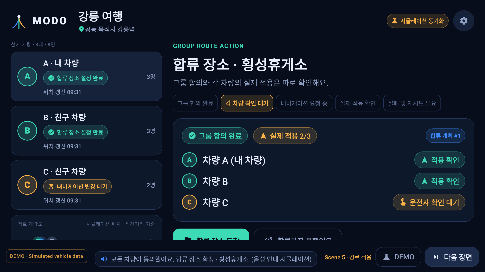
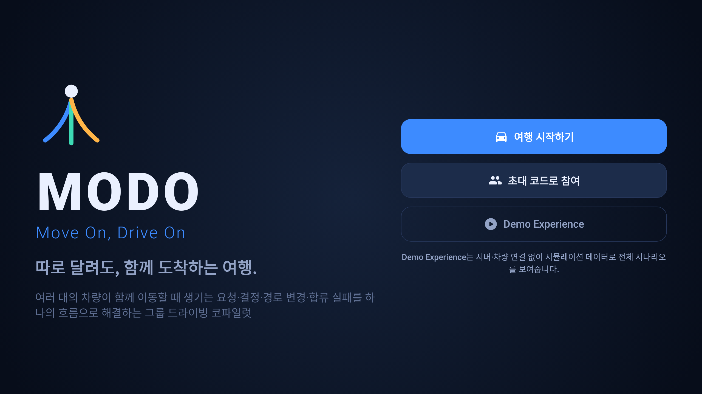
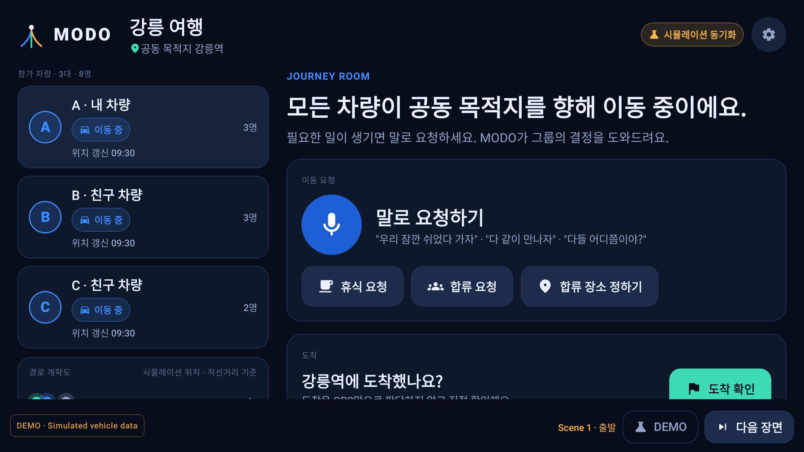
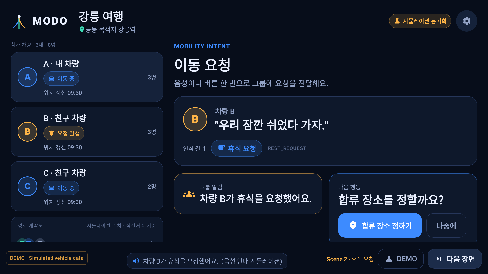
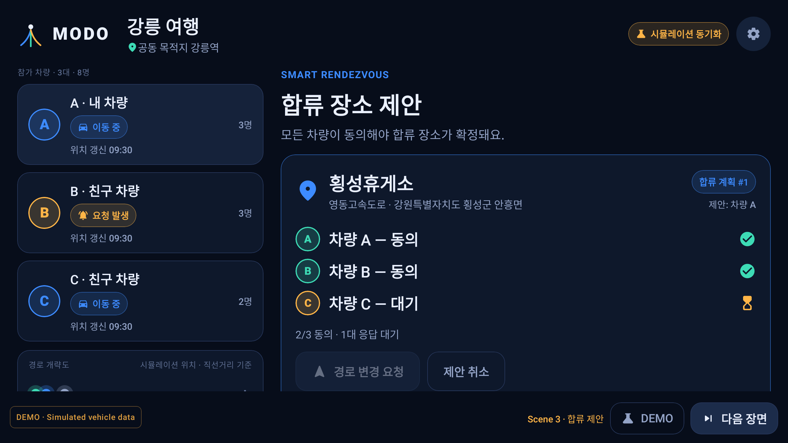
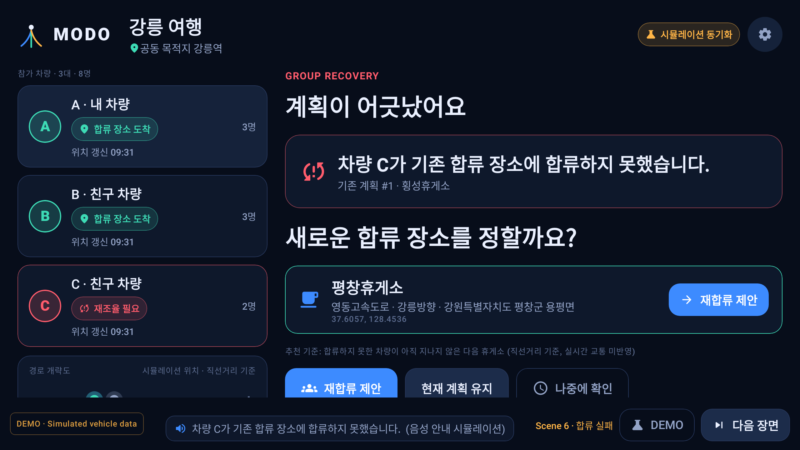
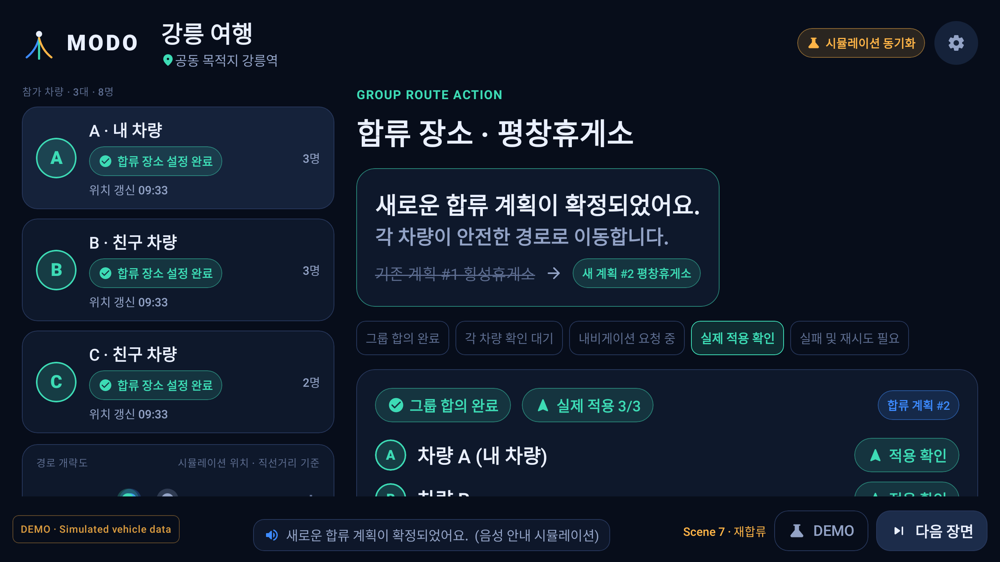
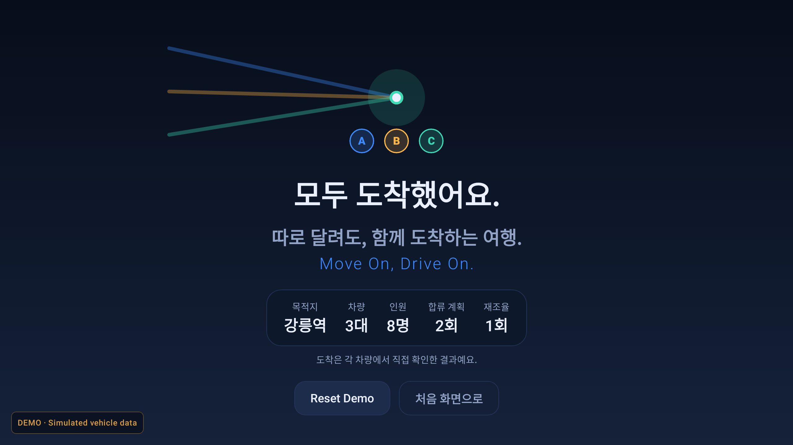

# MODO — Move On, Drive On

> 따로 달려도, 함께 도착하는 여행.

🎬 **시연 영상**: [docs/video/MODO_demo.mp4](docs/video/MODO_demo.mp4) (93초, Pleos Connect Emulator 실제 실행 화면) · 📦 **APK**: [apk/정지원_MODO_release.apk](apk/정지원_MODO_release.apk) · 📝 [제출 정보](docs/submission.md) · 팀 **정지원**

MODO는 여러 대의 차량이 함께 이동할 때 생기는 **이동 요청 → 그룹 의사결정 → 경로 변경 → 실행 상태 확인 → 합류 실패 복구**를 하나의 흐름으로 해결하는 Pleos Connect용 그룹 드라이빙 코파일럿입니다.

기존 위치 공유 앱은 일행의 위치를 보여줍니다. MODO는 함께 이동하는 과정에서 생기는 문제를 해결합니다.

## 제출 요약

| 항목 | 내용 |
|---|---|
| 앱 이름 | **MODO** (Move On, Drive On) · 팀 정지원 |
| 한 줄 소개 | 여러 차량이 함께 이동할 때 이동 요청부터 합류 장소 합의, 내비게이션 경로 적용 확인, 합류 실패 재조율까지 돕는 Pleos Connect 그룹 드라이빙 코파일럿 |
| APK 파일 위치 | [`apk/정지원_MODO_release.apk`](apk/정지원_MODO_release.apk) (release 빌드, 18.9MB) |
| 실행 방법 | [실행 방법](#실행-방법) — APK 설치 후 **Demo Experience** |
| 테스트 환경 및 필요한 설정 | [테스트 환경 및 필요한 설정](#테스트-환경-및-필요한-설정) |
| Pleos Connect 에뮬레이터 버전 | **Pleos Connect Emulator v2.1.0** (Android 14 / API 34, `pleos_car_emulator` arm64-v8a) |
| 화면 규격 | **2560×1440 px, 160dpi** (에뮬레이터 기본 디스플레이). 앱은 오른쪽 기본 창(약 1682×1210 px)에서 실행되며 창 분할·세로 창에도 비례 대응 |
| 시연 영상 | [docs/video/MODO_demo.mp4](docs/video/MODO_demo.mp4) |

| 핵심 | 내용 |
|---|---|
| Mobility Intent | 음성 또는 버튼 한 번으로 "휴식", "합류" 같은 이동 요청을 만들고 그룹에 공유 |
| Group Route Action | 모든 차량이 동의한 합류 장소를 각 차량 내비게이션에 적용 요청하고, **차량별 실제 적용 결과를 그룹 합의와 분리해서 확인** |
| Group Recovery | 경로 미적용·합류 실패 시 재조율 세션을 열고, 이전 계획과 구분되는 새 합류 계획을 다시 합의 |



## 화면

| | |
|---|---|
|  Welcome |  Journey Room |
|  Mobility Intent |  Smart Rendezvous |
|  Group Route Action |  Group Recovery |
|  재합류 확정 |  Journey Completed |

`docs/screenshots/*.png`는 실제 Compose 코드를 Robolectric으로 렌더링한 이미지이고, `docs/screenshots/emulator/*.png`는 **Pleos Connect Emulator v2.1.0에서 실제 실행한 화면**입니다 (왼쪽 Driving View·내비게이션 지도 표시 상태는 에뮬레이터 환경 제약, [SDK 검증 5절](docs/sdk-verification.md#5-에뮬레이터-환경-제약-앱-외부-요인) 참고).

## 결과물 위치

| 결과물 | 위치 |
|---|---|
| Android 앱 소스 | `app/` (Kotlin, Jetpack Compose) |
| 공유 도메인 엔진 | `core-domain/` (순수 Kotlin) |
| 그룹 동기화 서버 | `backend/` (Kotlin Ktor) |
| **Release APK** | `apk/정지원_MODO_release.apk` (팀: 정지원) |
| 아키텍처 | [docs/architecture.md](docs/architecture.md) |
| SDK 연동 검증 결과 | [docs/sdk-verification.md](docs/sdk-verification.md) |
| Demo Mode 안내 | [docs/demo-scenario.md](docs/demo-scenario.md) |
| 테스트 결과 | [docs/test-results.md](docs/test-results.md) |
| 시연 영상 | [docs/video/MODO_demo.mp4](docs/video/MODO_demo.mp4) · 제작 방법과 자막·내레이션: [docs/video/](docs/video/README.md) |

APK 정보: versionName 1.0.0 · applicationId `com.modo.drive` · minSdk 28 / targetSdk 34 · R8 축소 · APK Signature Scheme **v3** 서명 · 약 18.9MB.
release 빌드 타입으로 생성하고 팀 릴리스 키(`CN=MODO Team`)로 서명했습니다. 서명 키와 비밀번호는 저장소에 포함하지 않습니다.

## 개발 환경

| 항목 | 버전 |
|---|---|
| JDK | 17 (Temurin 17.0.16) |
| Gradle / AGP / Kotlin | 8.11.1 / 8.7.3 / 2.0.21 |
| compileSdk / targetSdk / minSdk | 35 / 34 / 28 (Pleos 요구: minSdk 28 이상) |
| UI | Jetpack Compose (BOM 2024.12.01), Material3 |
| 비동기·상태 | Coroutines 1.9.0, StateFlow |
| 직렬화 / 저장 | kotlinx.serialization 1.7.3 / DataStore Preferences |
| 서버 | Ktor 3.0.3 (Netty, WebSockets) |
| Pleos SDK | NaviHelper 3.0.5, FusedLocation 1.1.3, SpeechToText 3.3.1, TextToSpeech 3.3.1 |
| 에뮬레이터 | **Pleos Connect Emulator v2.1.0** (system-images;android-34;pleos_car_emulator;arm64-v8a, Android 14) |
| 테스트한 화면 규격 | 2560×1440 px @160dpi (에뮬레이터 기본, 앱 창 약 1682×1210 px), Robolectric 1280×720dp(가로) |

## 테스트 환경 및 필요한 설정

| 항목 | 내용 |
|---|---|
| 테스트 기기 | Pleos Connect Emulator v2.1.0 (Android 14 / API 34), 2560×1440 px @160dpi |
| 호스트 | macOS (Apple Silicon), Android Emulator 37.2, `-gpu swangle_indirect` (외장 GPU 없음) |
| AVD 설정 | Automotive · API 34 · "Pleos Connect v2.1.0 APIs" · RAM 4GB · **Cold boot** (Pleos 가이드 기준) |
| Demo Mode 필요 설정 | **없음** — 서버·네트워크·권한 없이 바로 실행 |
| 권한 | `NAVI_ROUTE`, `NAVI_ROUTE_SEARCH`, `STT_SERVICE`, `TTS_SERVICE`는 설치 시 자동 허용(에뮬레이터 확인). `FUSED_LOCATION`은 LIVE 모드에서 "내 위치 공유"를 켤 때 런타임으로 요청 |
| LIVE 모드 필요 설정 | 그룹 서버 실행(`./gradlew :backend:run`, 기본 포트 8080), 앱 서버 주소 기본값 `http://10.0.2.2:8080` |
| 실제 내비게이션 연동 확인 | Demo Controller(오른쪽 아래 **DEMO**) → "내 차량(A)에 실제 Pleos NaviHelper 사용" 켜기 → Scene 5 실행 |
| 음성 입력(STT) 확인 시 | 에뮬레이터 Extended Controls > Microphone에서 호스트 오디오 입력 허용 |

참고: 외장 GPU가 없는 환경에서는 Pleos 내비게이션 지도 영역이 검게 보이고 Driving View 차량이 기본 모델로 보일 수 있습니다(에뮬레이터 제약, MODO 동작과 무관).

## 실행 방법

### 1) 바로 설치
```bash
adb install apk/정지원_MODO_release.apk
```
런처에서 **MODO** 실행 → **Demo Experience**.

### 2) 소스에서 빌드
```bash
# local.properties 에 sdk.dir=<Android SDK 경로>
./gradlew :app:assembleDebug
adb install -r app/build/outputs/apk/debug/app-debug.apk
```
Pleos SDK는 공식 Maven 저장소(`https://nexus-playground.pleos.ai/repository/maven-releases/`)에서 받습니다 (`settings.gradle.kts`에 등록됨).

### 3) Pleos Connect Emulator
공식 가이드: [Setup Connect SDK & Emulator](https://document.pleos.ai/docs/connect/guide/getting-started/application-development/setup-connect-sdk-emulator)
- SDK Update Site(Mac): `https://nexus-playground.pleos.ai/repository/raw-releases/connect-avd/2.x/crp-arm64-sys-img.xml`
- Automotive · API 34 · "Pleos Connect v2.1.0 APIs", RAM 4GB, **Cold boot**
- 외장 GPU가 권장됩니다. Apple Silicon에서는 `emulator -avd <AVD> -gpu swangle_indirect -no-snapshot`로 검증했습니다 (`-gpu host`는 화면이 검게 나옴).

### 4) LIVE 모드 (그룹 서버 + Pleos SDK)
```bash
./gradlew :backend:run            # 기본 포트 8080 (PORT 환경변수로 변경)
```
앱에서 **여행 시작하기**(그룹 생성) 또는 **초대 코드로 참여**. 에뮬레이터에서 개발 PC 서버 주소는 기본값 `http://10.0.2.2:8080`입니다. 서버 동작 확인: `bash backend/scripts/smoke-test.sh` (포트 18080 기준, `MODO_SERVER`로 변경).

### Release APK 빌드
```bash
cp keystore.properties.example keystore.properties   # 값 입력, 키는 signing/ 아래 (둘 다 .gitignore)
./gradlew :app:assembleRelease
cp app/build/outputs/apk/release/app-release.apk "apk/정지원_MODO_release.apk"
```

## Demo Mode

서버·차량 없이 핵심 시나리오를 재현합니다. 자세한 장면과 조작은 [docs/demo-scenario.md](docs/demo-scenario.md).

- Welcome → **Demo Experience** → 오른쪽 아래 **다음 장면**으로 Scene 1~8 진행
- **DEMO** 버튼 → Demo Controller: Reset Demo, 장면 점프, 차량 C 상태 변경(동의/거절/운전자 확인/실패/응답 없음/합류 실패), 연결 끊김, 위치 갱신 중단, 네트워크 끊김, 음성 인식 실패 등
- 모든 조작은 실제 도메인 명령으로 상태를 바꾸며, Reset Demo는 상태·id·데모 시계를 완전히 초기화합니다. 같은 조작은 항상 같은 결과를 냅니다.
- **실제 동작 vs 시뮬레이션**: 데모의 앱 화면, 그룹 규칙, 상태 전이, 오류 처리는 실제 코드입니다. 차량 B·C의 행동과 모든 위치, 다른 차량의 경로 적용 결과, 음성 입력 문장, 음성 안내(소리 대신 자막)는 시뮬레이션입니다. 화면에 항상 `DEMO · Simulated vehicle data`가 표시됩니다.
- Demo Controller의 **내 차량(A)에 실제 Pleos NaviHelper 사용**을 켜면 내 차량의 경로 변경만 실제 SDK로 요청합니다.

## Pleos SDK 연동 현황

| SDK | 구현 | 에뮬레이터 검증 |
|---|---|---|
| NaviHelper | `PleosNavigationController`: initialize → addListener → requestRoute → 콜백 → getDestinationInfo로 적용 검증 → release | ✅ 실제 Pleos 내비게이션 앱이 MODO 요청 경로로 안내 시작, 계측 테스트 `Applied` |
| FusedLocation | `RealLocationProvider`: isSupported → initialize → register/unregister callback → release, 런타임 권한 요청 | ✅ 위치 수신 |
| SpeechToText | `PleosVoiceCommandController` (ON_DEVICE, ko-KR) | ⚠️ 초기화·요청까지 확인, **실제 발화 인식 미검증** |
| TextToSpeech | `PleosSpeechOutputController` (ON_DEVICE, ko-KR) | ⚠️ 초기화 성공 확인, **실제 소리 출력 미검증** |
| Vehicle | 미적용 | — |

문서와 실제 동작의 차이(예: `onRoutingCompleted` 미발생)와 대응은 [docs/sdk-verification.md](docs/sdk-verification.md)에 근거와 함께 정리했습니다.

## 테스트 결과 요약

| 구분 | 결과 |
|---|---|
| 도메인 단위 테스트 (JVM) | 26/26 통과 |
| 앱 통합·단위 테스트 (JVM) | 22/22 통과 |
| Compose UI 테스트 (Robolectric) | 8/8 통과 |
| Compose UI 테스트 (Pleos 에뮬레이터) | 6/8 통과 — 2건은 테스트 Activity가 RESUMED에 도달하지 못함(환경 요인 추정, 미확정) |
| Pleos SDK 계측 테스트 (에뮬레이터) | 4/4 통과 |
| 서버 테스트 / 스모크 테스트 | 5/5 통과 / 통과 |
| Release APK 에뮬레이터 시연 | Scene 1~8 크래시 없이 완료 |

```bash
./gradlew :core-domain:test :app:testDebugUnitTest :backend:test
```

## 알려진 제한사항

- 외장 GPU가 없는 Mac에서는 에뮬레이터가 소프트웨어 렌더링으로만 동작하며, 5~10분마다 에뮬레이터 프로세스가 종료되었습니다. Pleos 내비게이션 지도 영역이 검게 보이고, Driving View 차량이 기본 모델로 표시됩니다(Virtual Console 미설정). MODO 앱과는 무관합니다.
- STT 실제 인식과 TTS 실제 출력은 검증하지 못했습니다.
- 그룹 서버는 In-Memory 저장소라 재시작 시 여행이 사라지며, 인증이 없습니다(데모·개발용). 앱은 REST + 폴링을 사용합니다(서버의 WebSocket은 미사용).
- LIVE 모드로 2대 이상의 에뮬레이터를 동시에 연결한 시험은 하지 못했습니다.
- 합류 장소 후보는 데모용 휴게소 3곳(좌표: OpenStreetMap)이며, 추천은 "아직 지나지 않은 다음 휴게소" 직선거리 휴리스틱입니다. 실시간 교통·ETA는 반영하지 않고 표시하지도 않습니다.
- 경로 변경은 합류 장소를 목적지로 설정하는 방식입니다(경유지 방식 미사용).
- 주행 상태에 따른 조작 제한(Vehicle SDK)은 아직 없습니다. 차량 운행을 직접 제어하지 않으며, LIVE 모드에서는 운전자 확인 후에만 경로를 적용합니다.

## 향후 개발 계획

1. Vehicle SDK로 주행 중(기어 D, 속도) 조작 가능 범위 축소, 음성 우선 UX
2. 서버 영속 저장소(DB)와 참가자 인증, WebSocket 기반 실시간 동기화
3. NaviHelper 경유지 API로 최종 목적지를 유지한 채 합류 장소 추가
4. NaviHelper `onDestinationArrived` + 사용자 확인을 결합한 합류 도착 제안
5. 실시간 교통/ETA 기반 합류 후보 자동 추천 (검증된 데이터 소스 확보 후)
6. 외장 GPU 환경에서 복수 에뮬레이터 실시간 동기화 시험과 STT/TTS 실기 검증

---
MODO는 공모전 출품을 위한 독립 프로젝트이며 현대자동차그룹, 42dot의 공식 앱이 아닙니다. 공식 로고나 브랜드 자산을 사용하지 않았습니다.
